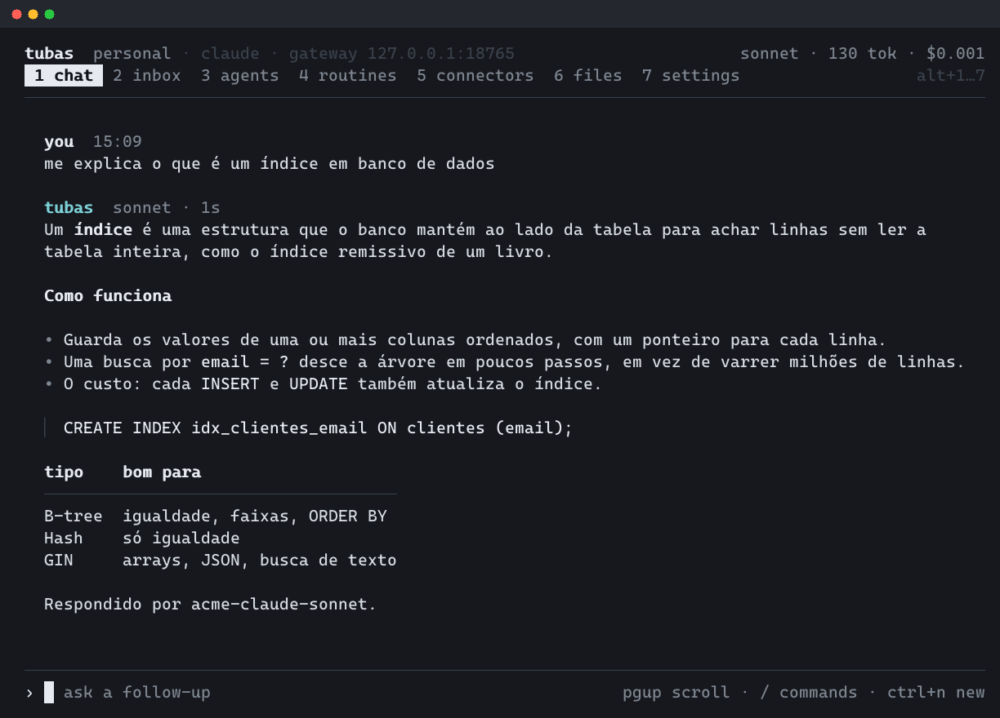
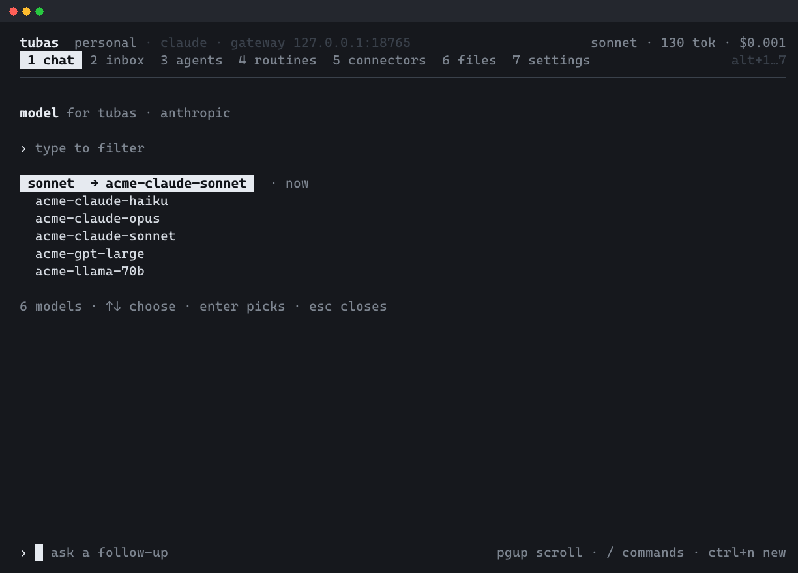
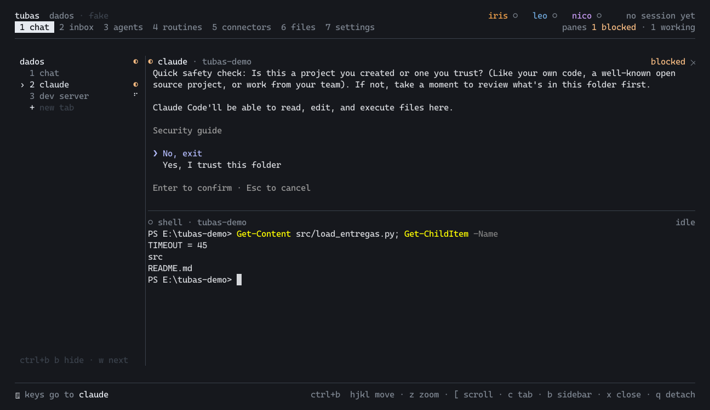
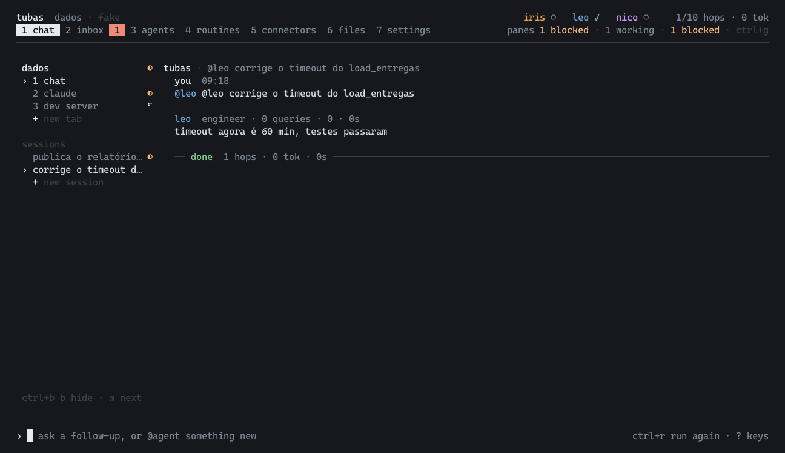

# tubas

A chat with AI in your terminal that grows into a team of agents, and every agent CLI you use, in one app.

- **Just talk:** type `tubas` and ask. It starts as a plain chat with one assistant, on the model and provider your Claude settings already use (your company's gateway included). `/model` lists every model your provider serves.
- **Your team, when you want one:** agents with a role, a model and their own tools hand work to each other with @mentions. You follow it all in a quiet chat and approve anything that touches the real world. Each agent runs on the harness you pick: Claude Code, Codex, any ACP agent (opencode, gemini, goose…), or tubas's own loop straight on a provider's API (DeepSeek, GLM, Kimi, Qwen, OpenRouter, a local Ollama).
- **Every other agent:** claude, codex, gemini or any command runs in a real terminal pane next to the chat, in its own git worktree if you want, with its state (blocked, working, done) always in sight.
- **It keeps working when you leave:** a background server holds the sessions, routines and panes. Close the window and come back later, from any terminal, by typing `tubas`.

It is easy to use, everything has a screen (no file needs editing by hand), and being a terminal app makes it light.

The name comes from the whale shark (*tubarão-baleia*): the biggest fish in the sea, always swimming with a school around it. Its mascot is the tubaleia, half shark and half whale shark.







## Install

You need [Go](https://go.dev) 1.26 or newer, and a way to reach a model: [Claude Code](https://claude.com/claude-code) signed in is the default (each agent turn runs as a `claude -p` process, on your account or the provider your Claude settings point to, see [Your AI provider](#your-ai-provider)). Codex, an ACP agent or just an API key work too: see [Harnesses and providers](#harnesses-and-providers).

```bash
go install .
```

That puts `tubas` in Go's bin folder (`~/go/bin`), which the Go installer adds to your PATH. From then on, type `tubas` in any terminal:

- inside a team folder, or any folder below it, it opens that team, the way git finds its repository;
- anywhere else, it opens your personal team in `~/.tubas/personal`, made the first time;
- `tubas init DIR` makes a new team for a project.

## Quick start

Type `tubas` anywhere and ask something. That's it: your personal tubas is a chat with one assistant.

- The whole answer shows, with headings, lists, code and tables; `pgup` `pgdown` (or the wheel) scroll back.
- Keep typing to continue the same conversation. `/new` (or `ctrl+n`) starts another; `ctrl+g` lists them all.
- `/model` (or `ctrl+o`) picks the model: Claude's, or every one your company gateway serves. Type to filter, `enter` to pick.
- `/agents` adds a teammate (an analyst, an engineer, a reviewer…). With two or more, they hand work to each other with @mentions and you see who does what.
- Type `/` to see every command, `?` for the keys.

### An example team

From this repository's folder, open the example team, a data team over a synthetic delivery database:

```bash
tubas -team examples/dados
```

1. Type `por que os pedidos caíram em março?` and press `enter`. A question that names no one goes to the team's lead (Iris here); write `@leo` anywhere in it to pick someone else.
2. When an agent wants to publish a report, the bar at the bottom waits for `y` (approve) or `n` (deny).
3. Press `ctrl+b` then `v`, then `enter`: your shell opens next to the chat. `ctrl+b` then `h` goes back to the chat.
4. Press `ctrl+b` then `q` to leave. Everything keeps running; `tubas` brings it back.

`tubas -team examples/dados -engine fake` runs the same team with scripted agents: no model calls, for offline demos.

## A team

A team is a folder:

```
my-team/
  team.yaml       name, lead, routing, hop limit, connectors
  agents/*.md     one file per agent
  routines.yaml   agents on a schedule (optional)
```

`team.yaml` says where tools come from. A **connector** is built into tubas, a git repository, or any [MCP](https://modelcontextprotocol.io) server that speaks stdio:

```yaml
name: support
example: "what changed in last week's tickets?"
lead: ana                 # answers when nobody else is picked (default: the first agent)
routing: router           # questions with no @: lead (default), router or all
max_hops: 6
notify: all               # all (default), window or off: see Notifications

connectors:
  db:                       # built in: read-only SQL over a SQLite file
    builtin: sqlite
    db: data/tickets.db
  reports:                  # built in: publish markdown reports to a folder
    builtin: reports
    dir: reports
    channel: "#support"     # the channel agents publish to by default
  api:                      # a git repository: see Code
    repo: E:/code/api
  github:                   # any MCP server tubas can start
    command: npx
    args: ["-y", "@modelcontextprotocol/server-github"]
    env: { GITHUB_PERSONAL_ACCESS_TOKEN: "${GITHUB_TOKEN}" }
    read: [search_issues, get_issue]   # optional: treat these as read-only
    write: [merge_pull_request]        # optional: treat these as writes
```

Each agent file gives the agent an access level per connector:

```markdown
---
name: ana
role: analyst
color: orange           # orange, blue, purple, green, pink or cyan
harness: claude         # what runs it: claude (default), codex, api, or an ACP agent (opencode…)
provider: deepseek      # where its model is served: anthropic (default, your Claude setup), deepseek, glm…
model: deepseek-v4-pro  # for claude on anthropic: haiku, sonnet, opus
effort: medium          # low, medium, high; parallel turns default to low
tools:
  db: read              # none, read or write
  github: write
can_call: [bia]         # who it may hand off to
token_limit: 50000      # the turn stops if its context grows past this
---
You are Ana, the support analyst...
```

- **none**: the agent does not see the connector.
- **read**: it sees only the tools that read. A tool reads when its server marks it so (`readOnlyHint`) or when `team.yaml` lists it under `read`.
- **write**: it sees every tool, and each one that writes waits for your `y` before it runs.

You rarely write these files by hand: agents › `n` makes an agent from a template, `enter` edits one, `p` opens the permissions table.

### Who answers

| You write | Who answers |
| --- | --- |
| `@leo is the load ok?` (or `@leo` anywhere) | Leo |
| `@todos what would you check first?` | everyone at once; whoever has nothing to add passes, and the lead closes the round |
| `is the load ok?` | the team's `routing`: the **lead**, a **router**, or **all** |

The router follows [agentes.chat's design](https://github.com/agentes-chat/agentes-chat/blob/main/docs/adr/0013-router.md): code picks the candidates, one cheap call (haiku, with a JSON schema) scores them, and code decides. It picks one agent, or several when the question speaks to the whole team; when nobody fits, the lead answers. The screen shows the pick and why (`→ router: @leo 0.80 · pipeline question`). Agents brought in this way may answer `PASS`; agents you name always answer.

### Workspaces of the agents

Every agent gets a folder of its own that survives between sessions, and the team gets a shared one, through the built-in `workspace` connector:

```
my-team/.tubas/workspaces/ana/   ana reads and writes here, no approval needed
my-team/.tubas/shared/           everyone reads and writes
```

Agents read each other's folders (`@leo/notes.md`) but write only in their own and in `shared/`. Paths cannot leave these folders. Set `workspace: read` or `none` in an agent's tools to limit it.

## Harnesses and providers

An agent's **harness** is what runs its loop; its **provider** is where its model is served. One team can mix them: Iris on Claude, Leo on Codex, Nico on DeepSeek, with the same tools, handoffs and approvals. As in agentes.chat, tucano and t3code, tubas offers only what this computer has (settings › harnesses and providers lists it), and nothing it installs.

| Harness | What runs the agent | Needs |
| --- | --- | --- |
| `claude` (default) | `claude -p` | Claude Code signed in, or a provider below |
| `codex` | `codex app-server`, the protocol tucano and t3code drive | Codex installed and `codex login` |
| an ACP agent: `opencode`, `gemini`, `goose`, `qwen`, `kimi`, `cursor`, `copilot`… | the [Agent Client Protocol](https://agentclientprotocol.com) | that CLI installed and signed in |
| `api` | tubas's own loop, calling the provider's API | an API key, or a local model |

| Provider | On `claude` | On `api` | Key |
| --- | --- | --- | --- |
| `anthropic` (default) | your Claude login or the gateway, Bedrock or Vertex in your Claude settings | Anthropic's API | `ANTHROPIC_API_KEY` (api only) |
| `deepseek`, `glm`, `kimi`, `qwen` | their Anthropic-compatible endpoints | the same | `DEEPSEEK_API_KEY`, `ZAI_API_KEY`, `MOONSHOT_API_KEY`, `DASHSCOPE_API_KEY` |
| `openrouter`, `openai`, `gemini` | — | their OpenAI-compatible endpoints | `OPENROUTER_API_KEY`, `OPENAI_API_KEY`, `GEMINI_API_KEY` |
| `ollama` | — | a local Ollama | none |

`provider:` in `team.yaml` sets the team's default. Add your own providers there, and harnesses that speak ACP; keys are named by their environment variable and never written to a file:

```yaml
provider: deepseek          # agents that name none
providers:
  work:
    anthropic: https://llm.example.com/anthropic   # Anthropic-compatible: claude and api
    openai: https://llm.example.com/v1             # OpenAI-compatible: api
    key_env: WORK_LLM_KEY
    models: [big-model, small-model]               # first: the default, last: the router's
    prices: { big-model: [3, 0.3, 15] }            # US$ per million tokens: input, cached, output
harnesses:
  dsh: { acp: "dsh --profile acp" }                # any agent that speaks ACP
```

Whatever the harness, the tools are the tubas gateway (the same MCP server for all), so access and approvals don't change:

- **codex** starts with its own shell and extras off and its approvals declined, as tucano does. A writer edits files in its worktree under codex's sandbox; shell commands go through the gateway's `run_command`, which waits for your `y`.
- **ACP agents** ask tubas before acting: reading is allowed, editing inside the worktree is allowed, a command waits for your `y`, anything else is refused, and "always" is never chosen.
- **api** agents get the gateway's file tools for their repositories (read, list, search, write in the worktree) and `run_command`.

What a turn cost: a subscription (Claude's or ChatGPT's) shows `plan` instead of a price; claude on Anthropic shows claude's own figure; an `api` turn is priced from `prices:` when you give them, else shows tokens only. A model that is not Claude's shows next to the turn (`· deepseek-v4-pro`).

## The app

Seven sections, always in the top bar: **chat · inbox · agents · routines · connectors · files · settings**. `alt+1` to `alt+7` opens one from anywhere, or click it. Outside the chat there is nothing to type, so `1`–`7` and `tab` move between sections too, and `esc` goes back to the chat.

| Section | What it shows · keys |
| --- | --- |
| chat | the conversation |
| inbox | everything waiting for you, with a count in the top bar: approvals from any session or routine (answered in any order with `y` / `n`), routine results, skills agents suggest |
| agents | each agent: model, effort, access, who it can call, skills, escalation, instructions. `n` new, `enter` edit, `p` permissions, `s` skills |
| routines | agents on a schedule: next run, last runs. `n` new, `enter` edit, `space` on/off, `r` run now, `d` delete |
| connectors | each connector, what runs it and each agent's access |
| files | what the agents wrote (workspaces, `shared/`, reports), newest first, with a preview |
| settings | routing, lead, hops, notifications, the AI providers found on this computer, quiet hours, retries. `e` edit, `r` look for AI again |

Every change is a form: `↑↓` moves, `←→` picks an option, letters type, `enter` on a long text (instructions, a routine's prompt, a skill) opens your `$EDITOR`, `ctrl+s` saves, `esc` cancels. Each form says which file it writes.

### Keys in the chat

| Key | What it does |
| --- | --- |
| `text`, `enter` | ask, or continue the conversation; in a team, `@agent` anywhere picks who answers, `@todos` asks everyone (`tab` completes) |
| `/` | the commands: `/model`, `/new`, `/agents`, `/help` |
| `pgup` `pgdown`, wheel | scroll the conversation |
| `ctrl+o` | change the model (the same as `/model`) |
| `y` / `n` | approve / deny what an agent wants to run |
| `v` | see the full call before deciding; after a session that changed code, review it |
| `↑` `↓` | scroll a plain chat; in a team, select a turn (`enter` expands or collapses it) |
| `tab` | in a team, the grid of all agents side by side |
| `esc` | back out one layer; stops the answer when nothing is open |
| `ctrl+r` | run the last question again |
| `ctrl+g` | all conversations, with their state |
| `ctrl+n` | a new conversation; the one on screen keeps running |
| `ctrl+b` then `q` | detach: close the window, leave everything running |
| `?` | keys panel |
| `ctrl+c` | quit (in a terminal pane, it goes to the program) |

Letters are always text, so a question can start with any word. Only `y`, `n` and `v` act on their own, and only while an approval is on screen. `ctrl+b` starts the pane keys, below.

### The mouse

Almost everything you reach with a key, you can click. `tubas -mouse=false` leaves the mouse to your terminal.

| Click | What it does |
| --- | --- |
| a section in the top bar | opens it; the count at the right opens the conversation list |
| a workspace, tab or conversation in the sidebar | shows it (a conversation opens in the chat) |
| `+ new tab`, `+ new conversation` in the sidebar | the same as `ctrl+b c` and `ctrl+n` |
| a pane | focuses it; drag over a terminal to select text, copied when you let go |
| a pane's header, twice | zooms it, twice again to go back |
| the `✕` in a pane's header | closes it (asks first while the program runs) |
| the border between two panes | drag it to resize them |
| `y` · `n` · `v` on an approval bar | approve · deny · details |
| a row in the conversation list or in a section's list | shows or selects it |

The wheel scrolls a terminal's history or the chat.

## Sessions and the background server

`tubas` starts a server for the team in the background (or finds the one already running), and the window attaches to it. Sessions, routines, approvals and panes live in the server, so closing the window, `ctrl+c` or `ctrl+b q` only detaches: agents keep working, routines keep running. Run `tubas` again to come back. Finished sessions are saved in `.tubas/sessions/`.

Each question you send is a session on the server; a follow-up is a new session in the same **conversation**, so the sidebar and `ctrl+g` list conversations (titled by their first question), not every message. Opening one replays it whole.

Every session has a state, the same on screen and on the command line: **blocked** (waits for you), **working**, **done** (finished, not seen yet) and **idle** (seen). The top bar sums them up (`1 blocked · 2 working`), the sidebar lists the conversations with their state, and the inbox gathers what every session waits for, not only the one on screen.



The server listens on 127.0.0.1 only, with a random token in `.tubas/server.json`. `-local` runs everything in the window instead (the fake engine and `-snapshot` always do).

## Code: repositories and a worktree per task

A git repository is a connector:

```yaml
connectors:
  api:
    repo: E:/code/api     # your checkout
    base: main            # tasks start from here (default: the branch checked out)
    setup: uv sync        # runs in every new worktree (optional)
```

Who works where is the permissions table: `api: write` for leo, `api: read` for nico.

- **read**: the agent reads, searches and lists files in your checkout, and changes nothing.
- **write**: the session gets its own git worktree in `.tubas/worktrees/`, on its own branch (`tubas/<session>-<title>`). The agent edits there freely. Every shell command waits for your `y`, with the exact command, why the agent wants it and where it runs; "always" is not offered. Anything outside the worktree is denied. Agents never commit, push or touch your checkout.

When the session ends, the chat shows what changed (`✎ api · 3 files · +12 −4 · v review`). `v` opens the review: the files and the diff; `m` merges into the base branch of your checkout (refused if your checkout is on another branch or has changes of its own), `p` pushes the branch and opens a pull request with `gh`, `d` (twice) discards the worktree and its branch.

## Panes: every agent CLI, next to the chat

Not every agent is a tubas agent. A pane is a real terminal inside tubas: claude, codex or gemini with their own screens, keys and prompts, your shell, a dev server, any command. Panes live in **tabs**, and tabs in **workspaces**: the team, each repository connector, and any folder you add.

| Key | What it does |
| --- | --- |
| `ctrl+b` then `v` / `-` | a new pane to the right / below the focused one |
| `ctrl+b` then `c` | a new tab, with a new pane |
| `ctrl+b` then `a` | the new pane menu, with the first agent CLI found picked |
| `ctrl+b` then `h` `j` `k` `l` (or arrows) | move between panes; `o` goes to the next one |
| `ctrl+b` then `n` / `p`, `1`…`9` | next / previous tab, tab by number |
| `ctrl+b` then `w` | the next workspace |
| `ctrl+b` then `N` | a new workspace, for any folder |
| `ctrl+b` then `b` | show or hide the sidebar |
| `ctrl+b` then `z` | zoom the focused pane, again to go back |
| `ctrl+b` then `[` | scroll back through the pane (copy mode) |
| `ctrl+b` then `x` | close the focused pane (asks first while the program runs) |
| `ctrl+b` then `r` | review what a pane changed in its worktree (merge, push, discard) |
| `ctrl+b` twice | send one `ctrl+b` to the program |

The new pane menu asks what to run (your shell, an agent CLI found on this computer, or any command, flags included) and where: the workspace's folder, the folder you opened tubas from, a repository's checkout, or **a new worktree** of it on its own branch (`tubas/p2-claude`), so a claude in a pane never touches your checkout either. In a repository's workspace, an agent gets a new worktree by default.

Keys go to the focused pane, `ctrl+c` included; tubas keeps only `ctrl+b` and `alt+1…7`. The chat is a pane too: move to it and type as usual.

**The sidebar** lists every workspace and its tabs with the state of what runs inside, and the team's sessions below them, so nothing waiting for you is out of sight. It shows up by itself once there are panes or a few sessions and the window is wide enough; `ctrl+b b` decides. Without it, a line of tabs sits above the panes.

**Copy mode** (`ctrl+b [` or the wheel) shows what the pane printed, 5000 lines back: `h` `j` `k` `l`, `w` `b`, `0` `$`, `g` `G`, `pgup` `pgdown` move; `/` searches back (`n` again, `N` forward); `v` starts a selection; `y` or `enter` copies it, or the line under the cursor; `q` goes back to the live terminal.

### States, read from the screen

Each pane has a state: **blocked** when the program asks something, **working** while it works, **idle** when it waits, **done** when an agent finished what you asked and you have not looked yet (or when the program exited). The pane's header, its tab in the sidebar and the top bar show them (`panes 1 blocked`).

tubas knows how a dozen agent CLIs show their state (claude, codex, gemini, qwen, copilot, opencode, crush, aider, goose, cursor-agent, amp, kimi): claude's "esc to interrupt" means working, its "Do you want to proceed?" blocked. It recognizes the agent by the program a pane runs, or, for a few with a distinctive banner, by its screen when you started it from a shell. Anything else gets the generic reading: a `(y/n)` or "Do you want to…" is blocked, printing on its own is working. Only claude's phrases have been checked against the real program so far.

To teach it another agent, or correct one, add a YAML file per agent to `~/.tubas/detect/` or the team's `detect/` folder (a file with a built-in's name replaces it):

```yaml
name: myagent
commands: [myagent]            # program names that run it
signature: ["myagent v1"]      # text only it prints, to spot it started from a shell
blocked: ["approve?", "(y/n)"]  # it asks you something
working: ["esc to cancel"]     # it is working
resume: ["--continue"]         # continues its last conversation, after a restart
```

### After a restart

Panes run in the background server, in a pseudo-terminal (ConPTY on Windows), with a terminal emulator keeping their screen: close the window and they keep running.

When the server itself restarts (`tubas stop`, a crash, the computer restarting), the panes come back too: each program starts again in its folder (its worktree included), in the same workspaces, tabs and layout, and agents that can continue their last conversation do (`claude --continue`, `codex resume --last`, `opencode --continue`, `aider --restore-chat-history`). What was running inside a shell does not come back, and a pane you closed, or whose program ended on its own, stays gone. The list lives in `.tubas/panes.json`.

A pane starts clean: the variables that mark a process as running inside a Claude Code session are not passed on, so a claude in a pane is a session of its own. The ones that pick your AI provider are.

## Notifications

When a pane or a session starts waiting for you, or an agent finishes, tubas tells you:

- in the window, unless you are looking at it: a notice and the terminal's bell;
- with no window open: a desktop notification (a balloon on Windows, Notification Center on macOS, notify-send on Linux).

`notify` in `team.yaml`, or settings, picks how loud: `all` (default), `window` (only in the window) or `off`.

## Agents that grow

### Model, permissions, escalation

- **Model and effort** are per agent. A change applies from the agent's next turn.
- **Permissions** (agents › `p`): every agent × every connector, `space` cycles none · read · write. Writes always wait for your `y`; an agent's own workspace is free.
- **Escalation**: an agent on a cheap model can ask a stronger one for the hard step, then go on. When the same tool fails twice the advice comes with the second failure (`tool_fails`); a write gets a review you see before you approve (`before_write`); or the agent calls `ask_senior` (`ask`). The senior gets a summary of the task's calls and errors, not the whole conversation, answers in a few lines, and shows in the chat as `↑ opus · $0.011: …`. Capped per agent and day.

```yaml
model: haiku
escalate:
  to: opus
  on: [tool_fails, before_write, ask]   # empty = all three
  per_day: 5
```

### The lead shapes the team

Every team has a `team` connector. The lead gets it with write access (others when you give it): it can **propose agents and routines** (`propose_agent`, `propose_routine`). Each proposal waits in the inbox with every field, like any write. A proposed agent can never get team access itself, and the lead can't change agents that already exist.

### Routines

`routines.yaml` in the team folder (or routines › `n`):

```yaml
quiet_hours: "22:00-07:00"   # nothing runs
retry: true                  # a failed run tries once more 5 minutes later
routines:
  - name: databricks-daily
    agent: leo
    every: weekdays 08:00     # 30m · 1h · daily 09:30 · mon,wed 10:00 · cron: 0 8 * * 1-5
    between: 08:00-20:00      # optional window, for intervals
    prompt: Check the nightly_orders job...
```

Routines run in the background server, with the window open or not. Each run is saved in `.tubas/runs/<name>/`, and its conclusion lands in the inbox (a run that answers `PASS` found nothing and stays quiet). Anything a routine wants to write waits in the inbox like the chat's approvals.

### Skills: agents learn from repeated work

When an agent does the same work (the same tools, in the same order) successfully 3 times, tubas drafts a skill from what the agent did, never from the text tools returned, and suggests it in the inbox: `y` saves it for that agent, `t` for the whole team, `e` edits it, `n` not now, `x` never. Skills live in `.tubas/skills/<name>/SKILL.md` (the Agent Skills format). An agent's prompt only carries each skill's name and when to use it; the steps load when the agent calls `load_skill`. In agents › skills (`s`) you edit them, give them to agents, archive and restore them, and add the ones already in `~/.claude/skills` (`a`).

## Tokens

Every step of an agent resends the whole conversation, so tubas keeps both the conversation and the number of steps small. Inspired by [agentes.chat](https://github.com/agentes-chat/agentes-chat/tree/main/docs/adr) (ADRs 0043, 0050, 0051):

- **A lean, stable base.** Agents run without Claude Code's own prompt and tools, and the system prompt and tool list never change during a session, so later steps read them from the cache (about a tenth of the price).
- **What a tool needs, in its description.** The SQLite connector puts the schema in `run_sql`'s description, so agents skip the discovery steps.
- **Few steps.** Agents are asked to call independent tools together in one step.
- **Small results.** A query returns at most 30 rows and 4,000 characters, with a note to aggregate or filter.
- **Short history.** Each turn leaves at most 800 characters for the next agents.
- **Less thinking where it matters less.** Agents working in parallel, or that may pass, run with `effort: low` unless their file says otherwise.
- **Honest numbers.** The screen shows tokens, the share read from cache and the cost: `34.9k tok · 58% cached · $0.005`.

Measured on the same question and model (haiku), one Iris turn went from 8 model calls, 23 tool calls, 57.8k tokens and US$ 0.0066 to 5 calls, 11–13 tool calls, about 35k tokens and US$ 0.004–0.005.

## Command line

Everything the window does, scripts and other agents can do too. Every command takes `-team DIR`; without it, tubas finds the team the same way as when you open it.

| Command | What it does |
| --- | --- |
| `tubas` | opens the team you are in, or your personal team |
| `tubas -team DIR` | opens the team in DIR |
| `tubas -resume` | reopens the team's last conversation |
| `tubas -ask "@agent ..."` | starts with that question |
| `tubas -model haiku` | every agent uses haiku (cheaper), ignoring their files |
| `tubas -engine fake` | scripted agents, no model calls |
| `tubas -local` | everything in this window, without the background server |
| `tubas -mouse=false` | leaves the mouse to your terminal |
| `tubas init DIR` | creates a new team to start from (a researcher and a reviewer) |
| `tubas seed` | recreates the team's example databases |
| `tubas status [-json]` | what runs and what waits for you: sessions, panes, routines |
| `tubas session new [-agent A] "question"` | starts a session (JSON back) |
| `tubas wait ID [-until blocked,done] [-timeout 10m]` | waits for a session's state |
| `tubas read ID [-last]` | a session's events, or only its conclusion |
| `tubas answer APPROVAL-ID yes\|no` | answers an approval (`tubas status -json` lists them) |
| `tubas pane new [-repo api [-worktree]] [-title T] [-- command ...]` | opens a pane (JSON back, with its id) |
| `tubas pane send ID "text" [-enter] [-key ctrl+c]` | types into a pane |
| `tubas pane wait ID [-until blocked,idle,done]` | waits for a pane's state |
| `tubas pane read ID` | a pane's screen as text (`-color` keeps the colors) |
| `tubas pane list [-json]`, `tubas pane close ID` | lists, closes |
| `tubas stop` | stops the server and every session and pane (panes come back with it) |

## How it works

```
                    you
                     │ @agent question                     ▲ y / n
                     ▼                                     │
 ┌──────────── tubas window (Bubble Tea) ──────────────────┴───┐
 │ chat · inbox · sections · panes · sidebar                   │
 └─────────────────────────────┬───────────────────────────────┘
                               │ HTTP on 127.0.0.1 (token)
 ┌──────────── tubas server, one per team ─────────────────────┐
 │ sessions (engine.Run) · routines · panes (ConPTY + emulator)│
 └──────────────┬──────────────────────────────────────────────┘
                │ one agent turn = one process
                ▼
     claude -p  --system-prompt <agent file + protocol>
                --tools ""  --mcp-config <tubas gateway>
                │ JSON-RPC over stdio
                ▼
     tubas mcp  the gateway: only this agent's tools
         │      writes ──▶ approval broker ──▶ your y / n
         ├── built in: sqlite (read-only), reports, workspace, team, skills
         └── any MCP server from team.yaml (started as a child)
```

- **Orchestrator vs harness.** Claude Code is the harness: it runs the agent loop. tubas is the orchestrator: it decides who runs next, with which instructions and tools, and shows what happens.
- **Turns are stateless.** Each agent gets the original question, a summary of each previous turn and the note it was handed. Contexts stay small and focused.
- **Handoff protocol.** An agent passes the work on by ending its answer with `HANDOFF @name: what you need`. tubas checks the name against the agent's `can_call`; anything else is refused and shown as ✗. Sessions stop at the team's hop limit.
- **Parallel work.** Several `HANDOFF` lines fan out: those agents run at the same time, each in its own goroutine, and answer back. The caller then concludes with all their answers. This is the orchestrator-workers pattern, live on screen.
- **Follow-ups.** Ask again after a session and the earlier questions and conclusions go to the agents as context. Each conversation is saved under `.tubas/history/`, and `-resume` reopens the last one.
- **The gateway.** Agents have no built-in tools (no shell, no file edits) unless they have access to a repository: read gives them claude's Read, Grep and Glob there, write adds edits and shell commands in their worktree, each command waiting for you. Their tools come from `tubas mcp`, which starts the team's connectors, lists only what the agent's access allows and holds every write until you approve it. Permissions live in code, not in the prompt.
- **Isolation.** Agents run with `--setting-sources ""`: your own CLAUDE.md, hooks and settings never reach them.

### Your AI provider

A work setup usually names the provider in the `env` block of `~/.claude/settings.json` (a company gateway in `ANTHROPIC_BASE_URL`, Bedrock, Vertex, a proxy or CA certificate, a script that fetches the token). Isolation would drop it, so tubas reads your user settings and the team folder's `.claude/settings.json` and `settings.local.json` itself, the way [tucano](https://github.com/eduwxyz/tucano) does, and hands the agents the whole `env` block. The header says which one is in use: `claude · gateway llm.example.com`. Nothing to configure in tubas: it picks your company's setup up on its own.

- **A token from a script.** When your settings fetch the key with an `apiKeyHelper`, claude gets it with `--settings`: it runs the script, sends the key, and runs it again when the gateway says 401. The api harness runs it itself (in sh, or Git Bash on Windows) and reuses the token for 5 minutes, or `CLAUDE_CODE_API_KEY_HELPER_TTL_MS`.
- **Your gateway's headers and model names.** `ANTHROPIC_CUSTOM_HEADERS` and `ANTHROPIC_DEFAULT_SONNET_MODEL` (and the opus and haiku ones) are passed on, so `model: sonnet` means whatever your gateway calls it. tubas also asks the gateway which models it serves (`/v1/models`, then `/models`), as tucano does: `/model` lists them all, next to the short names your settings map (`sonnet → acme-claude-sonnet`); a short name your settings don't map is left out, since the gateway would not know it. When the list can't be fetched, `/model` says why, and you can still type a model name.
- **Quiet behind a gateway.** Claude Code's telemetry and error reports are off (`DISABLE_TELEMETRY`, `DISABLE_ERROR_REPORTING`, `CLAUDE_CODE_DISABLE_NONESSENTIAL_TRAFFIC`): company networks often block them.
- **Your setup, not someone else's session.** When tubas itself runs inside a Claude Code session (the desktop app, its terminal), the variables of that session stay out of the agents, so they use your provider, not that session's login.
- **CLIs where installers put them.** `~/.local/bin`, `%APPDATA%\npm` and the like are searched, and on Linux and macOS the PATH of your login shell, so claude, codex or opencode are found even when tubas starts without your shell.
- **No Claude Code installed?** With a gateway (or a key) in your Claude settings, agents whose harness is `claude` run on tubas's own loop instead, straight on that gateway's Anthropic-compatible endpoint, with the same token, headers and model names. The header then says `api · gateway llm.example.com`. Bedrock and Vertex still need Claude Code, and so does escalation to a senior model.

### Packages

| Package | What it holds |
| --- | --- |
| `internal/agent` | reads, validates and saves the agent files |
| `internal/team` | reads `team.yaml`, checks agents against the connectors, saves settings |
| `internal/engine` | the `Engine` interface, `Run` (handoffs, hop limit), the harnesses (claude, codex, ACP, api, fake), model providers, the approval broker, detection |
| `internal/mcp` | the gateway: built-in tools, the client for external MCP servers, permissions, approvals, escalation |
| `internal/server` | the background server: sessions, routines, panes, notifications, its HTTP API and client |
| `internal/pane` | terminal panes: a pseudo-terminal per program, a terminal emulator for its screen, the state read from it, restore |
| `internal/repo` | git worktrees per task: create, diff, merge, push, discard |
| `internal/routine` | `routines.yaml`, schedules and saved runs |
| `internal/skill` | skills: the SKILL.md format, the learning tracker |
| `internal/notify` | desktop notifications |
| `internal/data` | the built-in SQLite connector and the synthetic delivery data |
| `internal/ui` | the window: chat, sections, forms, panes, sidebar, mouse |

## Development

```bash
go test ./...
```

To print one frame without opening the window (for tests and screenshots):

```bash
tubas -team examples/dados -engine fake -snapshot 128x32 -ask "@iris por que os pedidos caíram em março?" -keys "tab"
```

`-events N` stops after N engine events, to catch an agent mid-turn; `-keys` presses keys first (`v`, `y`, `tab`, `?`, `up up enter`…).

## Roadmap

- [x] Agent files, the chat, handoffs checked against `can_call`, the real engine on `claude -p`
- [x] The MCP gateway: permissions, approvals, any MCP server as a connector, general teams
- [x] Parallel handoffs, follow-ups, saved conversations, the router, `@todos`, a workspace per agent
- [x] Token savings, cost on screen
- [x] One app in seven sections: inbox, forms, permissions, routines, learned skills, escalation, the lead proposing agents and routines, AI providers from your Claude settings
- [x] The background server: detach and attach, sessions in parallel with states, routines with the window closed, the command line
- [x] Repositories as connectors, a worktree per task, review and merge
- [x] Panes for any agent CLI, with workspaces, tabs, a sidebar, the mouse, copy mode, per-agent states, notifications, and panes back after a restart
- [x] Agents on any harness and provider: Claude Code, Codex, ACP agents, tubas's own loop on an API; DeepSeek, GLM, Kimi, Qwen, OpenRouter, Ollama
- [ ] Remote (HTTP) MCP servers, remote machines over SSH
